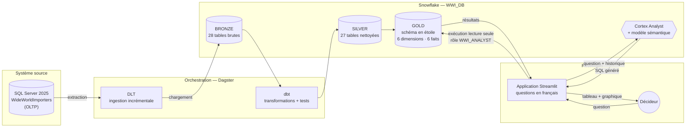
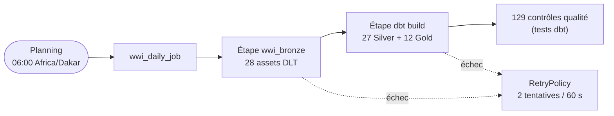
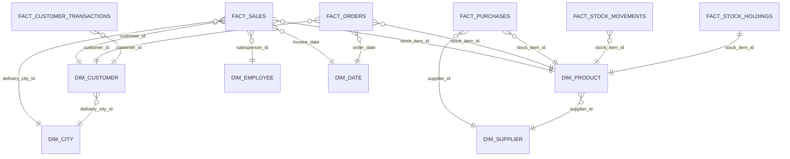
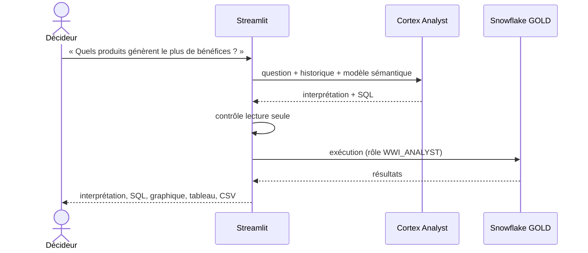

# Modern Data Platform WWI — Architecture Médaillon & Text-to-SQL avec Cortex AI

Projet de Master II Informatique, option Business Intelligence — Département de Mathématiques et Informatique,
FST, Université Cheikh Anta Diop de Dakar.

**Réalisé par :** Mouhamed DIOP — **Encadrant :** Dr Jean Gane SARR — **Rapport :** [`rapport/rapport.pdf`](rapport/rapport.pdf)

Plateforme de données moderne construite sur la base **Wide World Importers** (Microsoft) :
les données transactionnelles de SQL Server sont ingérées dans **Snowflake** avec **DLT**,
organisées en couches **Bronze / Silver / Gold** avec **dbt**, orchestrées par **Dagster**,
puis interrogées en **langage naturel** depuis une application **Streamlit** grâce à
**Snowflake Cortex Analyst**.

> « Quels sont les dix meilleurs clients par chiffre d'affaires ? » → SQL généré → tableau + graphique, sans écrire une ligne de SQL.

---

## Sommaire

1. [Architecture](#1-architecture)
2. [Structure du dépôt](#2-structure-du-dépôt)
3. [Prérequis](#3-prérequis)
4. [Installation pas à pas](#4-installation-pas-à-pas)
5. [Commandes du quotidien](#5-commandes-du-quotidien)
6. [Détail des couches](#6-détail-des-couches)
7. [Qualité des données](#7-qualité-des-données)
8. [Application Text-to-SQL](#8-application-text-to-sql)
9. [Sécurité](#9-sécurité)
10. [Industrialisation](#10-industrialisation)
11. [Dépannage](#11-dépannage)
12. [Rapport LaTeX](#12-rapport-latex)

---

## 1. Architecture



| Étape | Outil | Rôle |
|---|---|---|
| Source | SQL Server 2025 Developer | Base OLTP `WideWorldImporters` (ventes, achats, stocks, clients, fournisseurs, paiements) |
| Ingestion | DLT 1.31 | Extraction SQL Server → Snowflake `BRONZE`, chargement incrémental + merge |
| Stockage | Snowflake | Base `WWI_DB`, schémas `BRONZE`, `SILVER`, `GOLD`, entrepôt `WWI_WH` |
| Transformation | dbt-core 1.12 | Modèles SQL versionnés, documentés et testés (Silver puis Gold) |
| Orchestration | Dagster 1.13 | Lignage DLT → dbt, job quotidien, reprise sur erreur, contrôles qualité |
| IA | Snowflake Cortex Analyst | Traduction question en langage naturel → SQL sur la couche Gold |
| Interface | Streamlit | Conversation, SQL généré, graphiques automatiques, export CSV |

### Flux d'exécution quotidien (Dagster)



---

## 2. Structure du dépôt

```
projet_pratique_bi/
├── .env.example              # Modèle des paramètres de connexion (copier en .env)
├── requirements.txt          # Dépendances Python
├── dbt.ps1                   # Lance dbt avec les variables du .env
├── dagster.ps1               # Lance l'interface Dagster + le planificateur
├── streamlit.ps1             # Lance l'application Text-to-SQL
│
├── pyproject.toml            # Configuration du lint (ruff)
│
├── snowflake/
│   ├── 00_setup.sql          # Entrepôt, base, schémas, rôles, utilisateur technique
│   └── 01_ameliorations.sql  # Moniteur de crédits, droit de clonage (CI), schéma APP
│
├── ingestion/                # Couche BRONZE (DLT)
│   ├── wwi_pipeline.py       # Pipeline SQL Server -> Snowflake
│   └── check_bronze.py       # Réconciliation des volumes source / Bronze
│
├── transform/wwi_dbt/        # Couches SILVER et GOLD (dbt)
│   ├── dbt_project.yml
│   ├── profiles.yml          # Connexion Snowflake via variables d'environnement
│   ├── macros/               # clean_text, to_amount, dedup, surrogate_key, incremental_filter...
│   ├── models/silver/        # 29 modèles slv_* (dont 2 historiques) + sources + tests
│   ├── models/gold/          # 6 dim_* + 6 fact_* + 3 tables SCD2 + documentation + tests
│   ├── snapshots/            # Snapshot dbt du niveau de stock
│   └── tests/                # Tests métier (réconciliation, cohérence HT/TVA/TTC...)
│
├── orchestration/
│   ├── definitions.py        # Assets DLT + dbt, job, planning, reprise sur erreur
│   └── alerts.py             # Alertes d'échec (Slack / e-mail) + contrôles de fraîcheur
│
├── app/                      # Application Text-to-SQL
│   ├── streamlit_app.py      # Interface utilisateur (en-tête et pied de page UCAD)
│   ├── cortex_analyst.py     # Moteur Cortex Analyst (local ou Streamlit in Snowflake)
│   ├── semantic_model.yaml   # Modèle sémantique de la couche GOLD
│   ├── environment.yml       # Dépendances pour Streamlit in Snowflake
│   ├── LOGO-UCAD.png
│   └── test_questions.py     # Test de bout en bout des questions de référence
│
├── deploy/deploy_sis.py      # Déploiement dans Streamlit in Snowflake
├── ci/snowflake_clone.py     # Clone zéro copie de WWI_DB pour la CI
├── .github/workflows/ci.yml  # Intégration et déploiement continus
└── rapport/                  # Rapport LaTeX (rapport.pdf + sources, build.ps1)
```

---

## 3. Prérequis

| Composant | Version testée | Remarque |
|---|---|---|
| Windows | 11 | Scripts `.ps1` fournis ; adaptables sous Linux/macOS |
| Python | 3.13 | |
| SQL Server | 2025 Developer (2016 SP1 minimum) | Authentification Windows |
| Pilote ODBC | ODBC Driver 18 for SQL Server | |
| Snowflake | Compte d'essai Enterprise, AWS US West (Oregon) | Cortex Analyst disponible |
| Disque / RAM | 10 Go libres, 1,5 Go RAM pour SQL Server | |

---

## 4. Installation pas à pas

### 4.1 Restaurer la base WideWorldImporters

1. Télécharger **`WideWorldImporters-Full.bak`** (version OLTP) depuis la
   [page des versions Microsoft](https://github.com/Microsoft/sql-server-samples/releases/tag/wide-world-importers-v1.0).
   Ne pas prendre la version `DW` : l'entrepôt est reconstruit par ce projet.
2. Copier le fichier dans un dossier lisible par le service SQL Server
   (le dossier *Téléchargements* ne l'est pas), par exemple `C:\Users\Public\SQLBackups\`.
3. Restaurer :

```bash
sqlcmd -S localhost -E -C -Q "RESTORE DATABASE WideWorldImporters FROM DISK = N'C:\Users\Public\SQLBackups\WideWorldImporters-Full.bak' WITH MOVE 'WWI_Primary' TO N'C:\Program Files\Microsoft SQL Server\MSSQL17.MSSQLSERVER\MSSQL\DATA\WideWorldImporters.mdf', MOVE 'WWI_UserData' TO N'C:\Program Files\Microsoft SQL Server\MSSQL17.MSSQLSERVER\MSSQL\DATA\WideWorldImporters_UserData.ndf', MOVE 'WWI_Log' TO N'C:\Program Files\Microsoft SQL Server\MSSQL17.MSSQLSERVER\MSSQL\DATA\WideWorldImporters.ldf', MOVE 'WWI_InMemory_Data_1' TO N'C:\Program Files\Microsoft SQL Server\MSSQL17.MSSQLSERVER\MSSQL\DATA\WideWorldImporters_InMemory_Data_1', STATS = 10"
```

> Adapter `MSSQL17.MSSQLSERVER` au dossier de votre instance. L'option `-C` fait confiance
> au certificat local (nécessaire avec le pilote ODBC 18).

### 4.2 Préparer Snowflake

1. Créer un compte d'essai sur <https://signup.snowflake.com> (édition **Enterprise**, AWS, région US West ou US East).
2. Dans une feuille SQL Snowflake, ouvrir [`snowflake/00_setup.sql`](snowflake/00_setup.sql),
   **remplacer le mot de passe** de `WWI_PIPELINE_USER`, puis tout exécuter (*Run All*).
3. Exécuter ensuite [`snowflake/01_ameliorations.sql`](snowflake/01_ameliorations.sql) (moniteur de
   crédits, droit de clonage pour la CI, schéma `APP`).

Le script crée :

| Objet | Nom |
|---|---|
| Entrepôt (XS, suspension auto 60 s) | `WWI_WH` |
| Base et schémas | `WWI_DB.BRONZE`, `WWI_DB.SILVER`, `WWI_DB.GOLD` |
| Rôle pipelines (lecture-écriture) | `WWI_ENGINEER` |
| Rôle application (lecture GOLD + Cortex) | `WWI_ANALYST` |
| Utilisateur technique | `WWI_PIPELINE_USER` |

### 4.3 Configurer le projet

```bash
copy .env.example .env
```

Renseigner dans `.env` l'identifiant du compte (`SNOWFLAKE_ACCOUNT`, format `ORGNAME-ACCOUNTNAME`)
et le mot de passe choisi (`SNOWFLAKE_PASSWORD`). Ce fichier est exclu de Git.

### 4.4 Installer l'environnement Python

```bash
python -m venv .venv
```

```bash
.venv\Scripts\python.exe -m pip install -r requirements.txt
```

### 4.5 Premier chargement complet

```bash
.venv\Scripts\python.exe ingestion\wwi_pipeline.py
```

```bash
.\dbt.ps1 build
```

Ou, en une seule fois via Dagster :

```bash
.\dagster.ps1
```

puis, dans l'interface (<http://localhost:3000>) : **Jobs → wwi_daily_job → Materialize all**.

---

## 5. Commandes du quotidien

| Objectif | Commande |
|---|---|
| Ingestion incrémentale Bronze | `.venv\Scripts\python.exe ingestion\wwi_pipeline.py` |
| Ingestion de quelques tables | `.venv\Scripts\python.exe ingestion\wwi_pipeline.py --tables Sales.Orders Sales.Customers` |
| Rechargement complet Bronze | `.venv\Scripts\python.exe ingestion\wwi_pipeline.py --full-refresh` |
| Réconciliation SQL Server / Bronze | `.venv\Scripts\python.exe ingestion\check_bronze.py` |
| Construire et tester Silver + Gold | `.\dbt.ps1 build` |
| Seulement la couche Gold | `.\dbt.ps1 build --select gold` |
| Documentation et lignage dbt | `.\dbt.ps1 docs generate` puis `.\dbt.ps1 docs serve` |
| Interface Dagster + planning | `.\dagster.ps1` → <http://localhost:3000> |
| Exécuter le job sans interface | `$env:DAGSTER_HOME="$PWD\.dagster_home"; .venv\Scripts\dagster.exe job execute -m orchestration.definitions -d . -j wwi_daily_job` |
| Application Text-to-SQL | `.\streamlit.ps1` → <http://localhost:8501> |
| Tester les questions de référence | `cd app; ..\.venv\Scripts\python.exe test_questions.py` |
| Déployer dans Streamlit in Snowflake | `.venv\Scripts\python.exe deploy\deploy_sis.py` |
| Lint du code Python | `.venv\Scripts\ruff.exe check .` |
| Compiler le rapport PDF | `.\rapport\build.ps1` |

> Le planning quotidien ne se déclenche que lorsque `dagster.ps1` est lancé (il démarre le démon Dagster).

---

## 6. Détail des couches

### 6.1 Bronze — données brutes (DLT)

Fichier : [`ingestion/wwi_pipeline.py`](ingestion/wwi_pipeline.py)

- **30 tables** (dont 2 tables d'archive temporelles) des schémas `Application`, `Purchasing`, `Sales`, `Warehouse`, nommées
  `<schéma>_<table>` en minuscules (ex. `sales_invoice_lines`).
- **Chargement incrémental** : les tables possédant `LastEditedWhen` ou `ValidFrom` (tables temporelles)
  ne rechargent que les lignes nouvelles ou modifiées, fusionnées (*merge*) sur la clé primaire.
  Les autres tables (dont les tables `*_Archive`, sans clé primaire) sont remplacées intégralement.
- **Colonnes exclues** : types spatiaux (`geography`) et binaires (photos, mots de passe hachés).
- Lecture via SQLAlchemy + pyarrow ; état incrémental conservé par DLT (`~/.dlt/pipelines`).

### 6.2 Silver — données nettoyées (dbt)

Dossier : [`transform/wwi_dbt/models/silver`](transform/wwi_dbt/models/silver) — **29 tables `slv_*`** (dont `slv_stock_items_history` et `slv_customers_history`).

| Règle | Mise en œuvre |
|---|---|
| Texte normalisé | `trim`, chaînes vides → `NULL` (macro `clean_text`) |
| Montants | `NUMBER(18,2)` (macro `to_amount`) |
| Booléens et quantités | valeurs manquantes → `false` / `0` |
| Dédoublonnage | version la plus récente par clé (macro `dedup`) |
| Règles métier | montant HT = quantité × prix unitaire ; TTC = `extended_price` |
| JSON | pays de fabrication extrait de `custom_fields` |
| Minimisation | coordonnées bancaires et identifiants de connexion exclus |

### 6.3 Gold — schéma en étoile (dbt)

Dossier : [`transform/wwi_dbt/models/gold`](transform/wwi_dbt/models/gold)



| Table | Grain | Lignes | Contenu |
|---|---|---|---|
| `fact_sales` | ligne de facture | 228 265 | CA HT, TVA, TTC, bénéfice, quantité |
| `fact_orders` | ligne de commande | 231 412 | quantités commandées / préparées, reliquats |
| `fact_purchases` | ligne de bon de commande fournisseur | 8 367 | quantités et montants d'achat |
| `fact_customer_transactions` | transaction client | 97 147 | factures, paiements, solde restant dû |
| `fact_stock_movements` | mouvement de stock | 236 667 | entrées / sorties |
| `fact_stock_holdings` | produit (photo actuelle) | 227 | stock, valeur, alerte de réapprovisionnement |
| `dim_date` | jour | 1 461 | année, trimestre, mois et jours en français |
| `dim_customer` | client | 663 | catégorie, groupement d'achat, territoire, pays |
| `dim_product` | produit | 227 | marque, couleur, groupe, fournisseur |
| `dim_supplier` | fournisseur | 13 | catégorie, pays, délai de paiement |
| `dim_employee` | employé | 19 | dont commerciaux |
| `dim_city` | ville | 37 940 | État, territoire commercial, pays, continent |
| `dim_product_history` | version de produit (SCD2) | 671 | évolution des prix |
| `dim_customer_history` | version de client (SCD2) | 713 | crédit, catégorie, remise |
| `fact_stock_history` | version du stock (snapshot dbt) | 227+ | historique des niveaux de stock |

Les clés sont les identifiants naturels de la source (`customer_id`, `stock_item_id`…), ce qui
simplifie les jointures générées par l'IA.

---

## 7. Qualité des données

`.\dbt.ps1 build` exécute **189 nœuds** (44 modèles, 1 snapshot, 144 tests) ; dans Dagster, ils
apparaissent comme **75 assets** et **146 contrôles qualité**.

| Type | Exemples |
|---|---|
| Unicité / non-nullité | clé de chaque table Silver et Gold |
| Intégrité référentielle | chaque fait pointe vers une dimension existante |
| Valeurs autorisées | `direction` ∈ {Entrée, Sortie} |
| Règles métier | HT + TVA = TTC ; quantités vendues > 0 ; dates couvertes par `dim_date` |
| Historisation | exactement une version courante par produit et par client |
| Réconciliation | CA TTC Gold = CA TTC Bronze ; volumes SQL Server = Bronze (`check_bronze.py`) |

---

## 8. Application Text-to-SQL



- **Modèle sémantique** ([`app/semantic_model.yaml`](app/semantic_model.yaml)) : décrit les
  10 tables Gold, leurs relations, des synonymes français (« CA », « marge », « commercial »…),
  les indicateurs (`total_revenue`, `total_profit`, `margin_rate`…) et trois **requêtes vérifiées**
  correspondant aux questions du sujet.
- **Conversation** : les questions de suivi tiennent compte du contexte
  (« Et seulement pour les supermarchés, par mois en 2015 ? »).
- **Graphique automatique** : courbe pour une dimension temporelle, barres triées pour une
  catégorie, indicateur pour une valeur unique.

Exemples de questions :

- Quels sont les dix meilleurs clients par chiffre d'affaires ?
- Quel est le montant total des ventes par mois ?
- Quels produits génèrent le plus de bénéfices ?
- Quel est le taux de marge par territoire commercial en 2015 ?
- Quels commerciaux ont réalisé le plus de ventes en 2016 ?
- Quels produits sont sous le seuil de réapprovisionnement ?

> **Pourquoi Cortex Analyst plutôt que `CORTEX.COMPLETE` ?** Sur un compte d'essai Snowflake,
> les fonctions LLM génériques (`COMPLETE`, `AI_COMPLETE`, `AI_CLASSIFY`…) sont désactivées.
> Cortex Analyst, le service Snowflake dédié au text-to-SQL, reste disponible et produit un SQL
> plus fiable car guidé par le modèle sémantique.

---

## 9. Sécurité

- **Secrets** : uniquement dans `.env` (exclu de Git) ; jamais dans le code.
- **Moindre privilège** : l'application utilise le rôle `WWI_ANALYST`, limité à la **lecture du schéma GOLD**
  et à Cortex ; les pipelines utilisent `WWI_ENGINEER`.
- **SQL contrôlé** : avant exécution, l'application refuse tout ce qui n'est pas une instruction
  unique `SELECT` / `WITH` et tout mot-clé d'écriture (`INSERT`, `DROP`, `GRANT`…). Résultats limités à 10 000 lignes.
- **Données personnelles minimisées** dès la couche Silver (coordonnées bancaires, identifiants de connexion, photos exclus).

---

## 10. Industrialisation

| Amélioration | Mise en œuvre |
|---|---|
| **Historisation (SCD2)** | Tables d'archive temporelles de SQL Server ingérées → `dim_product_history` (prix) et `dim_customer_history` ; snapshot dbt `snp_stock_item_holdings` → `fact_stock_history` |
| **Modèles incrémentaux** | 10 modèles (6 Silver, 4 faits Gold) en `incremental` + `merge` (macro `incremental_filter`) : une exécution sans changement retraite 0 ligne |
| **Alertes** | `orchestration/alerts.py` : alerte Slack / e-mail à chaque run en échec, contrôles de fraîcheur des tables Gold (26 h) ; moniteur de crédits Snowflake (75 %, 90 %, suspension à 100 %) |
| **Streamlit in Snowflake** | `deploy/deploy_sis.py` publie l'application dans `WWI_DB.APP.WWI_INSIGHTS`, propriété de `WWI_ANALYST` ; même code qu'en local |
| **Intégration continue** | `.github/workflows/ci.yml` : ruff + validation YAML, `dbt build` sur un clone zéro copie `WWI_DB_CI_<run>`, redéploiement de l'application sur `main` |

Alertes : renseigner au besoin dans `.env` `SLACK_WEBHOOK_URL` ou `ALERT_EMAIL_TO`, `SMTP_HOST`,
`SMTP_PORT`, `SMTP_USER`, `SMTP_PASSWORD`.

CI : ajouter les secrets GitHub `SNOWFLAKE_ACCOUNT`, `SNOWFLAKE_USER`, `SNOWFLAKE_PASSWORD`
(*Settings → Secrets and variables → Actions*) et avoir exécuté `snowflake/01_ameliorations.sql`.

Limites restantes : compte d'essai (30 jours, fonctions LLM génériques indisponibles) ; source SQL Server
locale (en production, l'ingestion tournerait sur un serveur ayant accès à la source).

---

## 11. Dépannage

| Symptôme | Cause / solution |
|---|---|
| `sqlcmd` : *certificate chain was issued by an authority that is not trusted* | Ajouter `-C` (ODBC 18 chiffre par défaut) |
| `RESTORE` : *Operating system error 5 (Accès refusé)* | Copier le `.bak` dans un dossier lisible par le service SQL (`C:\Users\Public\SQLBackups`) |
| DLT : *QueuePool limit of size 5 overflow 10 reached* | Déjà corrigé : le moteur utilise `NullPool` (une connexion par table extraite en parallèle) |
| Cortex : *AI function … is not available for trial accounts* | Normal sur un compte d'essai pour `COMPLETE` ; l'application utilise Cortex Analyst |
| Cortex Analyst : *Invalid semantic model yaml* | Une expression contenant une virgule doit être entre guillemets dans le YAML |
| Dagster : `manifest.json` introuvable | Lancer `.\dbt.ps1 parse` (ou passer par `.\dagster.ps1`, qui le régénère) |
| Les scripts `.ps1` sont bloqués | `Set-ExecutionPolicy -Scope CurrentUser RemoteSigned` |
| Dagster : *The dbt executable 'dbt' was not found on PATH* | Corrigé : `definitions.py` ajoute le dossier de l'environnement virtuel au `PATH` |
| CI : *Insufficient privileges … CREATE DATABASE* | Exécuter `snowflake/01_ameliorations.sql` en `ACCOUNTADMIN` |

---

## 12. Rapport LaTeX

Le rapport complet (45 pages) est dans [`rapport/rapport.pdf`](rapport/rapport.pdf) ; les sources sont
dans `rapport/` (`rapport.tex` + un fichier par chapitre dans `rapport/chapitres/`, figures dans
`rapport/figures/`). Pour le recompiler (MiKTeX ou TeX Live requis) :

```bash
.\rapport\build.ps1
```

